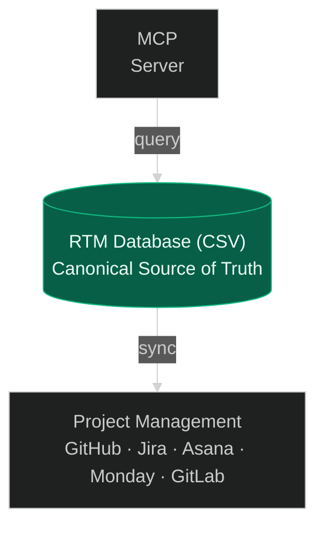

RTMX adapters connect your requirements database to issue trackers, boards, and AI agents.

## Available Adapters

| Adapter | Description |
|---------|-------------|
| [Project Management](/docs/adapters/project-management) | GitHub Issues, Jira, Asana, Monday.com, GitLab Issues — one hub, provider tabs |
| [MCP Server](/docs/adapters/mcp) | AI agent integration via Model Context Protocol |

## Architecture



## Sync philosophy

RTMX uses **CSV as the canonical store**:

1. **Git-friendly**: CSV diffs are human-readable
2. **AI-parseable**: Token-efficient for LLM context
3. **Portable**: No vendor lock-in
4. **Audit-ready**: Full history via git

External trackers sync through a shared CLI shape:

```bash
rtmx sync --service github
rtmx sync --service jira
rtmx sync --service asana
rtmx sync --service monday
rtmx sync --service gitlab
```

Provider-specific credentials and yaml live on the [Project Management](/docs/adapters/project-management) page (tabs).

## Bootstrap

Import requirements from any PM adapter (same flags as tests):

```bash
rtmx bootstrap --from-github --dry-run
rtmx bootstrap --from-jira
rtmx bootstrap --from-asana
rtmx bootstrap --from-monday
rtmx bootstrap --from-gitlab
```

## Security

- Credentials in environment variables (or Sync vault for Asana OAuth)
- No tokens in config files
- Minimal permission scopes requested
